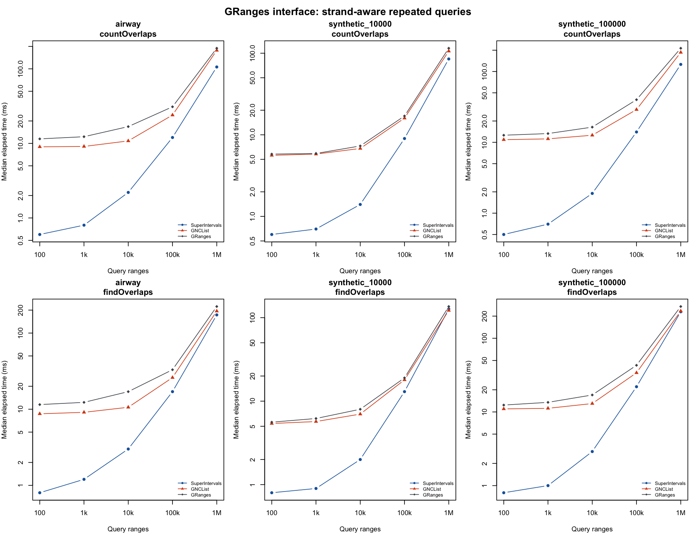

# superintervalsr

`superintervalsr` is an R wrapper for the SuperIntervals C++ library, designed
for repeated overlap queries on an indexed collection of intervals. It is being
prepared for Bioconductor submission and is not yet available there.

## Installation

Install dependencies from CRAN and Bioconductor, then install the source package:

```r
install.packages(c("Rcpp", "remotes"))
install.packages("BiocManager")
BiocManager::install(c("S4Vectors", "IRanges", "GenomicRanges"))
remotes::install_github("kcleal/superintervalsr")
```

A C++17 compiler is required. See `BIOCONDUCTOR.md` for development checks and
submission steps.

## Quick start

```r
library(superintervalsr)
im <- IntervalMap(c(20, 1, 5), ends = c(30, 10, 15),
                  values = c("C", "A", "B"))
count.batch(im, c(7, 25), c(12, 35))
search_items(im, 7, 12)
search_point(im, 10)
coverage(im, 1, 15) # count = 2, total_coverage = 21 inclusive bases

# Incremental loading: build once after adding all intervals.
im <- IntervalMap()
reserve(im, 1000)
add(im, 1, 10, "A")
add(im, 5, 15, "B")
build(im)
search_values(im, 7, 12)
```

Intervals and queries are **closed**: both endpoints are included. Inputs must
be finite whole numbers in the R integer range (excluding `NA`). Constructors
validate coordinates and build automatically. Query functions retain a thin,
low-overhead interface: callers must provide valid query ranges and call
`build()` after every batch of additions. Index state is not checked per query.

`build()` sorts starts ascending and ends descending within tied starts. Search
indices address this internal order, not original input rows. Hit order and the
choice of metadata among identical coordinate ties are unspecified. For mapping
back to source rows, store row IDs as values.

## Genomic ranges

Use the S4 `SuperIntervalMap` adapter to index GRanges with multiple chromosomes,
strand, sequence information and metadata. Build once and reuse the subject:

```r
library(GenomicRanges)
gr <- GRanges(c("chr1", "chr1", "chr2"),
              IRanges(c(20, 1, 1), c(30, 10, 10)),
              strand = c("+", "*", "-"),
              gene_id = c("C", "A", "D"))
index <- SuperIntervalMap(gr)
query <- GRanges(c("chr1", "chr2"), IRanges(c(5, 3), c(25, 8)),
                 strand = c("+", "-"))
hits <- findOverlaps(query, index)
countOverlaps(query, index)
as_granges(index)[subjectHits(hits)]
```

Hits refer to original subject rows. Strand matching follows GenomicRanges,
including wildcard `"*"`; use `ignore.strand = TRUE` to ignore it. Advanced overlap
options and zero-width features use GenomicRanges directly. The genomic adapter
uses up to three indexes per sequence to speed repeated queries. Reconstruct it
after editing subject coordinates; save its original GRanges for serialization.
The workflow vignette includes a real RNA-seq example using `airway` annotations.

The low-level `IntervalMap(gr, seqname = "chr1")` interface still indexes one
sequence and ignores strand. Its search indices address sorted map positions;
store row IDs as values when mapping low-level hits to original input rows.

## GRanges interface benchmarks

On macOS ARM64 with R 4.6.1/Bioconductor 3.24 (14 October 2026), the
chromosome- and strand-aware interface produced the same counts and hit pairs as
GenomicRanges. The benchmark uses real airway gene spans and two synthetic
subjects across 22 chromosomes, with 100, 1,000 and 10,000 promoter queries.
Both strand-aware and strand-ignored queries are tested. Timings below are
medians of five repetitions of ten calls; subject indexes are built once and
construction time is recorded separately. Units are milliseconds per batch.

| Subject | Operation | Queries | SuperIntervals | Prebuilt GNCList | GRanges |
|---|---|---:|---:|---:|---:|
| airway | countOverlaps | 10,000 | 4.2 | 10.8 | 17.4 |
| airway | findOverlaps | 10,000 | 7.5 | 10.9 | 17.3 |
| synthetic_10000 | countOverlaps | 10,000 | 3.5 | 7.2 | 7.8 |
| synthetic_10000 | findOverlaps | 10,000 | 6.3 | 7.3 | 8.2 |
| synthetic_100000 | countOverlaps | 10,000 | 3.8 | 15.0 | 18.6 |
| synthetic_100000 | findOverlaps | 10,000 | 7.9 | 15.0 | 18.8 |

For the 63,677 airway gene spans, the SuperIntervals genomic index took 56 ms
to build, versus 17 ms for GNCList. For 100,000 synthetic features, the times
were 85 ms and 20 ms. This favors reusing the index across batches: a single
query can cost more overall once construction is included. These are observed
timings on this machine and dataset; results vary with overlap density and
hardware. Memory usage is not compared because ordinary R object-size tools do
not account for the C++ index allocations.



The [complete results](inst/benchmarks/queries.csv),
[construction timings](inst/benchmarks/build.csv), and
[session information](inst/benchmarks/session-info.txt) are included.
To reproduce from the repository with the required vignette dependencies:

```sh
Rscript inst/scripts/benchmark-genomic.R genomic-benchmark
```

## Set operations

`merge_overlaps()`, `union_with()`, `intersection()`, `difference()`,
`symmetric_difference()`, `gaps()`, `expand()`, `flank()` and
`unique_intervals()` return independent, already indexed maps. `span()` returns
the enclosing start/end pair or `NULL` for an empty map.

Merge and union coalesce overlaps, but keep adjacent non-overlapping intervals
separate. Intersection returns one piece per overlapping pair, retaining the
left input's value; use `merge_overlaps()` for disjoint output. Difference
retains the left input's metadata, while expansion and flanks inherit each
source interval's value. These operations do not reconcile all metadata from
both inputs. Consult the help pages for exact value semantics.

`coverage()` returns the number of hits and the sum of inclusive intersection
widths. Shared bases are counted once per stored interval, so this is not union
width or the per-base coverage returned by `IRanges::coverage()`.

Maps mutate by reference: `other <- im` aliases the same map. External-pointer
maps cannot be restored with `readRDS()`; save coordinates and values and
reconstruct them. Qualify names such as `superintervalsr::coverage()` and
`superintervalsr::flank()` when working alongside Bioconductor packages.
